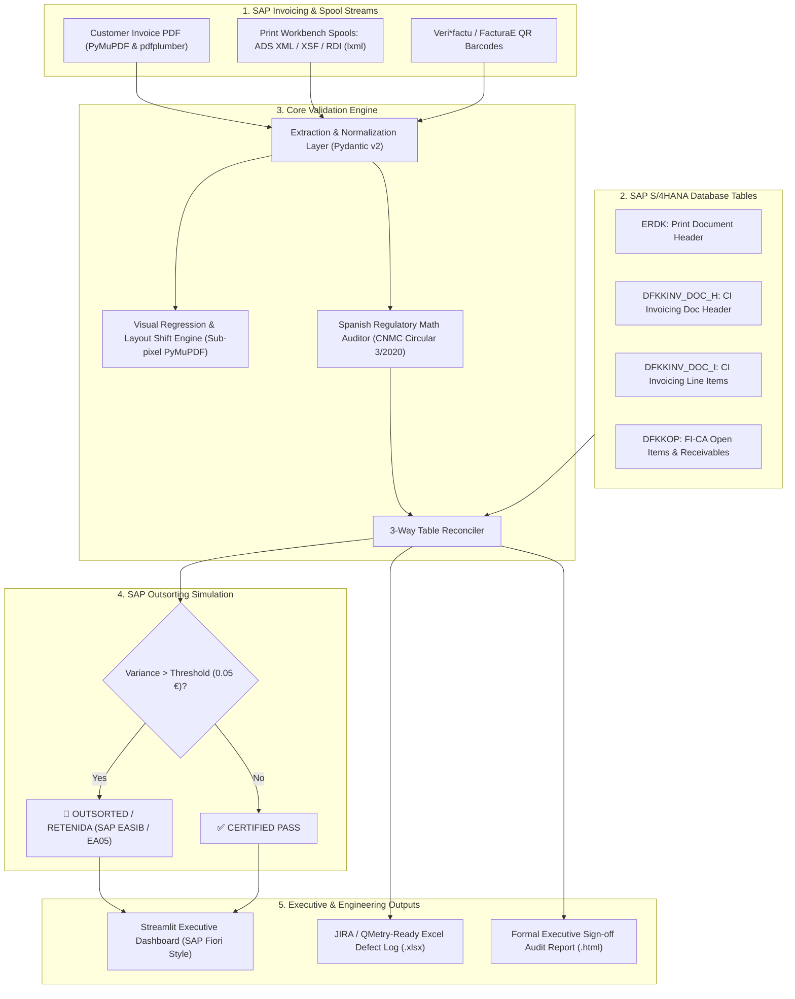

# SAP IS-U & CI Automated Bill Print & Invoice Validation Suite (Spain Utility Edition)

[](https://www.python.org/downloads/)
[](https://streamlit.io)
[](https://pytest.org)
[](https://www.cnmc.es)
[](https://opensource.org/licenses/MIT)

An enterprise-grade, automated **3-Way Reconciliation and Visual Regression Testing Suite** designed for **SAP S/4HANA Utilities (IS-U)** and **SAP Convergent Invoicing (CI)** implementations within the Spanish energy and utilities sector (e.g., Endesa, Iberdrola, Naturgy, TotalEnergies, and municipal distribuidoras).

This solution eliminates manual billing regression testing by cross-validating customer invoice documents (PDF, Adobe Document Services ADS, SmartForms, and Print Workbench `EFRM` RDI/XML streams) against **Spanish statutory regulations (CNMC & BOE)** and **SAP backend transactional tables (`ERDK`, `DFKKINV_DOC_H`, `DFKKINV_DOC_I`, `DFKKOP`)**.

---

## 🏗️ Architecture & Data Pipeline

The suite ingests customer-facing billing documents and raw SAP spool outputs, normalizes the data into strictly typed Pydantic models, conducts regulatory math recalculations, and reconciles line-by-line against SAP backend postings.



---

## ⚡ Key Capabilities

### 1. Spanish Regulatory & Mathematical Validation Engine
- **Término de Potencia ($P_1 \dots P_6$):** Independent calculation according to CNMC Circular 3/2020 and Real Decreto 148/2021 ($\text{kW} \times \text{días} \times \text{precio\_kW\_día}$).
- **Término de Energía ($P_1 \dots P_6$):** Active energy calculation ($\text{kWh} \times \text{precio\_kWh}$).
- **Impuesto sobre la Electricidad (IEE):** Statutorily validated against Ley 38/1992 (art. 64 ter) and emergency decree-laws ($5.11269632\%$, $3.8\%$, $2.5\%$, $0.5\%$), including enforcement of the statutory minimum rate ($0.50\text{ €/MWh}$).
- **Financiación del Bono Social:** Regulated daily fee based on Orden TED statutory rates.
- **Alquiler de Contador:** Regulated CNMC rates distinguishing Monophasic ($0.81\text{ €/mes}$ for domestic $\le 15\text{ kW}$) and Triphasic ($1.36\text{ €/mes}$ for commercial/industrial $> 15\text{ kW}$).
- **Base Imponible & IVA:** Exact VAT calculation ($21\%$, $10\%$, $5\%$) with banker's rounding.
- **SAP Outsorting Simulation:** Replicates SAP IS-U transactions `EASIB` and `EA05`. Invoices exceeding tolerance ($> 0.05\text{ €}$) or containing invalid tax rates are automatically flagged as **`OUTSORTED` (`RETENIDA`)**.

### 2. SAP 3-Way Table Reconciliation
- **ERDK:** Validates gross print document total (`TOTAL_AMNT`), company code (`BUKRS`), contract account (`VKONT`), and business partner (`GPART`).
- **DFKKINV_DOC_H:** Reconciles CI net invoicing header amount and active document status (`INV_STATUS = 0`).
- **DFKKINV_DOC_I:** Line-by-line validation for sub-application items (`POWER`, `ENERGY`, `IEE`, `EQUIPMENT`, `BONO_SOC`, `VAT`) and tax codes (`V1`, `V0`, `V2`, `I1`).
- **DFKKOP:** Validates that the FI-CA open item receivable (`BETRW`) and due date (`FAEDN`) match the customer invoice (`BLART = 'ED'`).

### 3. Visual & Layout Regression Diff with Dynamic Masking
- **Dynamic Field Masking:** Automatically masks runtime variables that differ between print runs (SAP Spool IDs e.g. `SPOOL_00018928`, print timestamps e.g. `15/11/2026 14:12:08`, ADS session tokens, and page counters).
- **Sub-Pixel Layout Shift Detection:** Flags bounding box displacements exceeding configurable thresholds ($> 2.5\text{ pt}$), catching table shifts, font substitutions, and margin slips.
- **Color-Coded Visual Overlays:**
  - 🟢 **Green:** Static and calculated field match.
  - 🔵 **Blue:** Layout displacement (Layout Shift).
  - 🟠 **Amber:** Dynamic runtime field masked.
  - 🔴 **Red:** Arithmetic or textual regression defect.

### 4. Veri\*factu / FacturaE QR Barcode Decoding
- Detects and decodes embedded QR codes to ensure full compliance with the Spanish Tax Agency (**Agencia Tributaria - AEAT**) Veri\*factu specifications (NIF, Invoice Number, Issue Date, Gross Total).

### 5. Automated JIRA / QMetry Audit Reports
- Exports pre-formatted Excel workbooks (`.xlsx`) with conditional formatting, executive KPI summaries, 3-way reconciliation matrices, and copy-paste-ready defect descriptions for **JIRA / QMetry** bug logging.
- Generates self-contained, printable Executive HTML sign-off audit certificates.

---

## 📂 Repository Structure

```text
sap-bill-validator/
├── app.py                        # Streamlit Multi-Tab Dashboard (SAP Fiori design)
├── cli.py                        # Headless CLI runner for batch SIT/UAT execution
├── requirements.txt              # Core Python dependencies
├── .gitignore                    # Production gitignore (security & client data guard)
├── config/
│   └── spanish_tariff_rules.yaml # Tolerances, regex patterns, statutory IVA & IEE rates
├── src/
│   ├── __init__.py
│   ├── models.py                 # Pydantic v2 schemas for Spanish bills & SAP tables
│   ├── pdf_extractor.py          # Coordinate & regex extractor for Spanish utility PDFs
│   ├── xml_rdi_parser.py         # SAP Print Workbench RDI / XSF / XML spool parser
│   ├── sap_reconciler.py         # 3-way matching engine against ERDK, DFKKINV, DFKKOP
│   ├── spanish_tax_validator.py  # Regulatory math validator (Potencia, Energia, IEE, IVA)
│   ├── visual_diff.py            # PyMuPDF pixel & bounding-box overlay for layout shifts
│   └── report_generator.py       # JIRA/QMetry-ready Excel and HTML sign-off reports
├── utils/
│   ├── locale_parser.py          # Converts Spanish '1.234,56 €' strings to Python Decimal
│   └── sample_data_generator.py  # Realistic Spanish utility PDFs, XMLs, and SAP CSVs
├── tests/
│   └── test_reconciler.py        # Pytest suite covering rounding & outsorting edge cases
├── data/
│   ├── baseline/                 # Baseline reference PDF bills
│   ├── target/                   # Target test bills (PDF & XML spools)
│   └── sap_tables/               # SAP backend exports (ERDK, DFKKINV_DOC_H/I, DFKKOP)
└── reports/                      # Generated Excel and HTML sign-off audit reports
```

---

## 🚀 Quickstart Guide

### 1. Clone & Set Up Environment

```bash
# Clone the repository
git clone https://github.com/ViditUpreti/sap-isu-ci-bill-validator.git
cd sap-isu-ci-bill-validator

# Create and activate virtual environment
python -m venv venv
source venv/bin/activate  # On Windows: .\venv\Scripts\activate

# Install dependencies
pip install -r requirements.txt
```

### 2. Generate Synthetic Spanish Utility Test Data

The project includes an authentic data generator that creates realistic Spanish electricity and gas bills with dynamic spool IDs, QR codes, companion XML spools, and SAP backend CSV exports:

```bash
python -c "from utils.sample_data_generator import SampleDataGenerator; SampleDataGenerator('.').generate_all()"
```

### 3. Run Automated Pytest Suite

```bash
pytest tests/test_reconciler.py -v
```

**Test Execution Summary:**
```text
tests/test_reconciler.py::TestSpanishLocaleParser::test_parse_spanish_currency_string PASSED [  7%]
tests/test_reconciler.py::TestSpanishLocaleParser::test_format_spanish_currency PASSED [ 15%]
tests/test_reconciler.py::TestSpanishLocaleParser::test_parse_spanish_date PASSED [ 23%]
tests/test_reconciler.py::TestSpanishTaxValidator::test_tariff_20td_exact_math PASSED [ 30%]
tests/test_reconciler.py::TestSpanishTaxValidator::test_rounding_edge_case_within_tolerance PASSED [ 38%]
tests/test_reconciler.py::TestSpanishTaxValidator::test_outsorting_trigger_on_large_discrepancy PASSED [ 46%]
tests/test_reconciler.py::TestSpanishTaxValidator::test_invalid_tax_rate_rejection PASSED [ 53%]
tests/test_reconciler.py::TestParsers::test_pdf_extraction_baseline PASSED [ 61%]
tests/test_reconciler.py::TestParsers::test_xml_spool_parsing PASSED     [ 69%]
tests/test_reconciler.py::TestSapReconciliation::test_clean_3way_match PASSED [ 76%]
tests/test_reconciler.py::TestSapReconciliation::test_fica_posting_imbalance_detection PASSED [ 84%]
tests/test_reconciler.py::TestVisualDiff::test_dynamic_masking_ignores_spool PASSED [ 92%]
tests/test_reconciler.py::TestVisualDiff::test_layout_shift_detection PASSED [100%]
============================== 13 passed in 6.71s ==============================
```

### 4. Run Headless CLI Batch Runner (CI/CD SIT/UAT)

```bash
# Run headless batch test across all target bills
python cli.py

# Run with custom tolerance and return exit code 1 if any invoice is outsorted
python cli.py --tolerance 0.01 --exit-code-on-fail
```

### 5. Launch Interactive Streamlit Dashboard

```bash
streamlit run app.py
```
Open **`http://localhost:8501`** in your browser (or access via the server's public IP).

---

## 🌐 Production & Cloud Deployment Guide

The application is pre-configured with `.streamlit/config.toml` (binding to `address = "0.0.0.0"` and `headless = true`) and accepts dynamic cloud `$PORT` variables for seamless deployment across any hosting provider:

### Option 1: Streamlit Community Cloud (Zero-Config)
1. Go to [share.streamlit.io](https://share.streamlit.io).
2. Connect your GitHub account and select repository **`ViditUpreti/sap-isu-ci-bill-validator`**.
3. Set **Branch:** `main` and **Main file path:** `app.py`.
4. Click **Deploy!** The synthetic dataset will auto-seed and launch immediately.

### Option 2: Docker Container (AWS ECS / GCP Cloud Run / Azure / Local)
```bash
# Build the container image
docker build -t sap-bill-validator .

# Run container mapping port 8501
docker run -d -p 8501:8501 --name sap-validator sap-bill-validator
```
Access at `http://<your-host-ip>:8501` or your domain.

### Option 3: Render / Railway / Heroku
The included [`Procfile`](file:///C:/Users/vidit/.gemini/antigravity/scratch/sap-bill-validator/Procfile) automatically handles dynamic cloud `$PORT` routing:
```text
web: streamlit run app.py --server.port=$PORT --server.address=0.0.0.0
```

---

## 🖥️ Streamlit Multi-Tab Executive Dashboard

| Tab | Feature | Description |
|---|---|---|
| **Tab 1: 📊 Executive SIT/UAT Overview** | KPI Metrics & Charts | Pass Rate %, Outsorted Bills count, Financial Variance (€), Total Billed Exposure (€), Tariff breakdown table, and quick status filter. |
| **Tab 2: 🔍 Visual & Layout Diff** | PyMuPDF Overlay Inspector | Side-by-side view (Baseline vs Target vs Overlay) with dynamic spool masking toggle, and bounding-box layout shift inspector ($(\Delta x, \Delta y)\text{ pt}$). |
| **Tab 3: ⚖️ Regulatory & Math Auditor** | Step-by-Step CNMC/BOE Audit | Full formula audit verifying Potencia ($P_1\dots P_6$), Energía ($P_1\dots P_6$), IEE, Bono Social, Contador, and IVA with legal citations. |
| **Tab 4: 🗄️ SAP 3-Way Reconciliation** | Backend Table Matching | Cross-table matching against `ERDK`, `DFKKINV_DOC_H`, `DFKKINV_DOC_I`, and `DFKKOP` with drilldown on CI line items. |
| **Tab 5: 📲 Veri\*factu QR & Spool XML** | QR Code & Spool Explorer | Veri\*factu QR payload decoder (NIF, Invoice No, Date, Total) and raw SAP XML / RDI spool viewer. |
| **Tab 6: 📥 Audit & Defect Center** | Export to JIRA / QMetry | One-click download of formatted 4-sheet Excel audit workbook and self-contained HTML executive sign-off report with live JIRA defect preview. |

---

## ⚖️ Regulatory Standards Covered

- **Circular 3/2020 de la CNMC:** Calculation methodology for electricity transmission and distribution access tolls.
- **Real Decreto 148/2021:** Calculation methodology for electricity system charges.
- **Ley 38/1992 de Impuestos Especiales (art. 64 ter):** Special Electricity Tax (IEE) and statutory minimum rates.
- **Real Decreto-ley 8/2023:** Temporary tax reduction measures for energy products in Spain.
- **Ley 37/1992 del Impuesto sobre el Valor Añadido (IVA):** Standard ($21\%$), reduced ($10\%$), and super-reduced ($5\%$) VAT rules.
- **Orden TED/733/2022 & RD 897/2017:** Economic regime and financing of the Social Bonus (Bono Social).
- **Orden ITC/3860/2007 & Resoluciones CNMC:** Regulated metering equipment rental tariffs (monophasic and triphasic).

---

## 👤 Author & Acknowledgments

- **Lead Architect & Developer:** Vidit Upreti ([GitHub](https://github.com/ViditUpreti))
- **Domain Focus:** SAP S/4HANA Utilities (IS-U), SAP Convergent Invoicing (CI), FI-CA, Spanish Energy Regulations (CNMC).
- **License:** MIT License.
